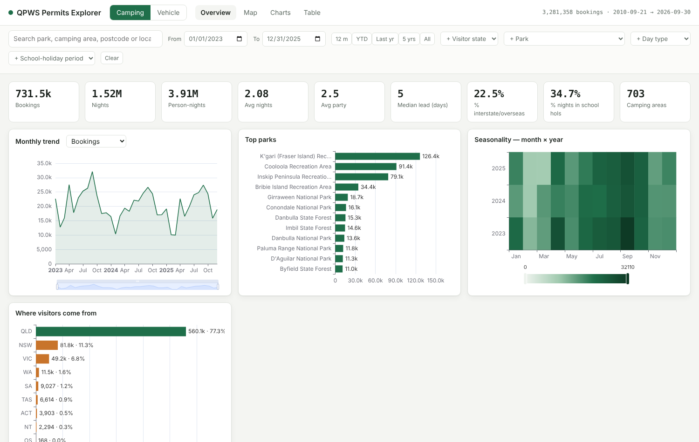
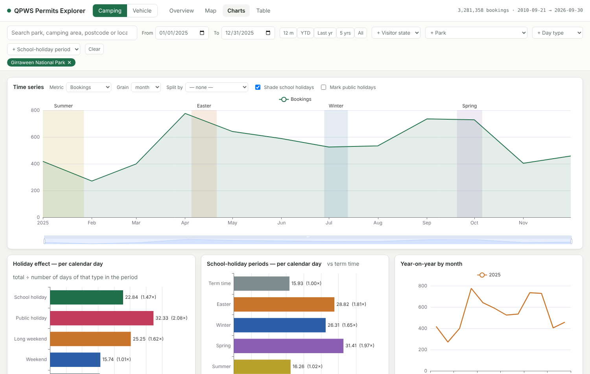
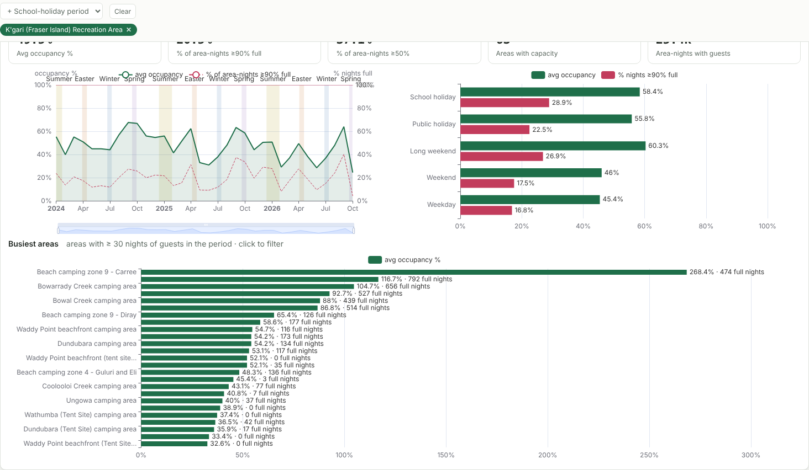

# QPWS Permits Explorer

**Live:** [qpws.mutant.kiwi](https://qpws.mutant.kiwi)

Fifteen years of Queensland national-park camping and vehicle-access permits — **3.3 million camping bookings and
2.8 million vehicle permits, January 2011 to September 2026** — on a map, in charts and in a searchable table, with
school holidays, public holidays and campground capacity layered over the top.



## What you can do

- **Map** camping areas sized by bookings, nights or person-nights; switch to *visitor origin* to see which postcodes
  campers come from (green Queensland, orange interstate); or draw postcode → campground **flow lines** for a park.
  Colour areas by **occupancy** against their current site or people cap.
- **Chart** monthly/weekly/daily trends with school-holiday periods shaded, year-on-year overlays, seasonality heatmaps,
  length of stay, party size, booking lead time, day of week, and breakdowns by park, area, visitor state or region.
- **Compare day types fairly**: bookings *per calendar day* on school holidays, public holidays, long weekends, weekends
  and ordinary weekdays — long weekends run at about twice a normal weekday statewide.
- **Measure pressure**: average and peak occupancy per campground, the share of nights booked out, and which areas sell
  out most — by period, by park, or on long weekends only.
- **Filter everything at once** — date range, park, camping area, visitor state or postcode, permit duration, day type,
  school-holiday period, free text — and share the view as a URL.
- **Plan a stay**: pick a campground and future dates (to end‑2029) and see how full it was on the *equivalent* nights in
  each of the last few years — matched by named public holiday, by day‑of‑school‑holiday‑period, or by weekday — with
  the day types for your dates. Castle Rock at Easter has been 100% full three years running; now you know before you book.
- **Single‑campground view**: selecting one campground (⛺, orange) overlays nightly sites‑or‑people in house and the
  capacity line on the time series.
- **Fees and revenue**: the camping and vehicle‑permit fee schedules for every financial year since 2009–10, and an
  *estimated* revenue measure (fee × nights × chargeable people; permit × area/duration fee) usable in every chart,
  KPI and map — about $128M camping and $120M vehicle to date, within ~10% of the audited 2022–23 figures.
- **Export** any filtered slice as CSV, or hit the JSON API directly (`/api/docs`).




## Data

| Source | What | Notes |
|---|---|---|
| QPWS / DETSI permit exports | camping bookings and vehicle access permits, 2011 → | 90 CSV files in six different layouts, reconciled by `etl/etl.py` |
| Queensland National Parks Booking Service | camping-area coordinates, site types and capacity | public BookEasy endpoints (`bookeasy_operators.csv`, `bookeasy_rooms.csv`) |
| education.qld.gov.au | state-school term dates 2010–2029 | `data/raw/lookups/qld_school_terms.csv` |
| QPWS fee schedules (legislation, QoN 1010/2023, Wayback) | camping and vehicle permit fees 2009–10 → 2026–27 | `data/raw/lookups/fees.csv` |
| `holidays` (Python) | Queensland public holidays | includes the Royal Queensland Show and Labour Day moves |
| Australia Post / ABS via [matthewproctor/australianpostcodes](https://github.com/matthewproctor/australianpostcodes) | postcode centroids, localities, SA4 | `data/raw/lookups/postcodes.csv` |

Camping and vehicle data are deliberately kept as **two separate tables** — a stay and an access entitlement are
different things — and only compared where it makes sense.

### Caveats worth knowing
- Raw exports are not in this repo (size, and they're sourced separately); the processed Parquet tables are, so the
  app runs from a clone.
- The 2016–2025 exports were one row *per night*; they are rolled up to one row per booking, de-duplicated across
  quarters. Exports from 2025 carry no booking IDs, so a conservative de-duplication rule is used (see
  [docs/DEVELOPMENT.md](docs/DEVELOPMENT.md)).
- February–March 2025 is thin in the source data (booking-system changeover).
- Campground **capacity is today's site configuration applied to all years**, so areas that have been re-zoned show
  >100% in earlier years. Treat occupancy as a relative signal.
- A day inside a school-holiday period is labelled "School holiday" even if it is also a public holiday or long weekend.
- Camping-area names changed spelling many times across exports ("M.V. Sarawak" / "MV Sarawak", tent/trailer sub-sites of one campground); they are merged under the booking site's current name, with the as-exported name kept in the table.
- **Revenue is an estimate**, not takings: concessions, refunds, the family rate and counter‑sale mix are approximated,
  so it runs roughly 5–13% from audited figures. Nominal dollars.
- Vehicle permits carry no coordinates; recreation areas are shown at approximate centroids.

## Stack

FastAPI + [DuckDB](https://duckdb.org) querying Parquet in-process (no database server) · MapLibre GL · Apache ECharts ·
Tabulator · deployed on [Fly.io](https://fly.io) (Sydney) with the data baked into the image.

```
etl/        raw CSV → Parquet (+ data-quality report)
app/        API and static front end
data/       lookups and Parquet outputs
docs/       developer notes, screenshots
```

## Run it

```bash
pip install -r requirements.txt
uvicorn app.main:app --port 8080        # http://localhost:8080
```

To rebuild the data, drop the permit CSVs into `data/raw/{camping,vehicle,legacy}` and run `python etl/etl.py`
(≈ 1 minute). Pushing to `main` deploys to Fly via GitHub Actions. Developer detail, schema, API reference and the
how-to for adding a new quarter are in [docs/DEVELOPMENT.md](docs/DEVELOPMENT.md).

## Licence

Code: MIT. The permit data belongs to the Queensland Government (Department of the Environment, Tourism, Science and
Innovation); treat the processed tables here as derived data for exploration, not an official statistic.

